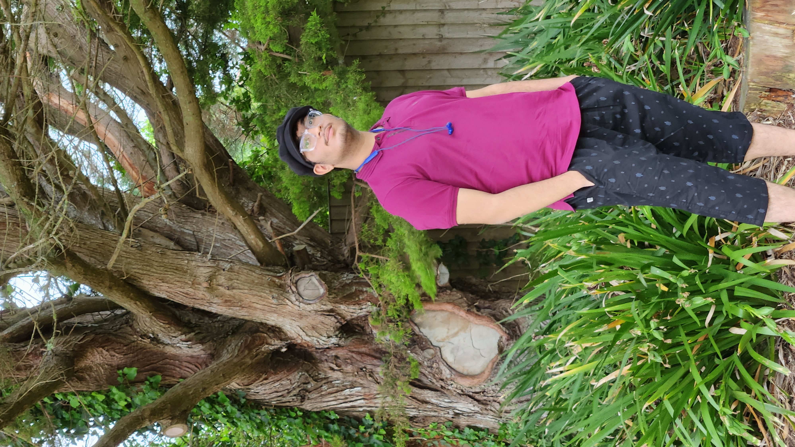

 Hi, Stranger! Welcome to my corner of the internet.

I am a Research Scientist in the pretraining science team at <a href="https://mistral.ai/">Mistral AI</a>. I recently graduated from the <a href="https://www.cse.iitd.ac.in/">Department of Computer Science &amp; Engineering</a> at <a href="https://home.iitd.ac.in/">IIT Delhi</a>, where I worked on algorithms for clustering problems with <a href="https://www.cse.iitd.ac.in/~rjaiswal/">Ragesh Jaiswal</a>.

I enjoy thinking about the design and analysis of algorithms related (and unrelated) to the practice of modern information processing. Much of my work explores how structural assumptions can break through worst-case computational barriers.

During my undergraduate years, I spent many memorable summers with <a href="https://www.comp.nus.edu.sg/~rahul/">Rahul Jain</a> in the <a href="https://www.cqt.sg/groups/computer-science/">Computer Science Group</a> at the <a href="https://www.cqt.sg/">Centre for Quantum Technologies, Singapore</a>, where I studied cryptographic primitives based on pseudorandom quantum states; with <a href="https://makarandtapaswi.github.io/">Makarand Tapaswi</a> at <a href="https://www.wadhwaniai.org/">Wadhwani AI</a>, where I worked on training VAEs for self-supervised learning from unlabeled data for newborn anthropometry; and at <a href="https://www.linkedin.com/company/atlas-research-ai/">Atlas Research</a> as a quantitative trading and research intern. I also visited the <a href="https://uwaterloo.ca/math/">Faculty of Mathematics at the University of Waterloo</a> for a semester as an exchange student.

Outside research, I am a percussionist with a particular interest in Indian classical instruments, and occasionally <a href="/writing/">write</a>.

<ul class="profile-links">
<li><a href="poojan-shah-cv.pdf">Curriculum vitae</a></li>
<li><a href="https://scholar.google.ca/citations?hl=en&amp;view_op=list_works&amp;gmla=AOv-ny_OFkMHrWUMPNHQCyvv05avR8LXUHY6vYYfLZpDepuWzLy1DVgpFu_KIZzge24Ap-uclYsDnkziNSYbtu0dH-nr&amp;user=uedBN20AAAAJ">Google Scholar</a></li>
<li><a href="https://github.com/PoojanCShah/">GitHub</a> · <a href="https://linkedin.com/in/poojan-shah-b077ab25b/">LinkedIn</a> · <a href="https://x.com/PoojanShah6380">X</a></li>
<li><a href="mailto:shahpoojan2004@gmail.com">shahpoojan2004@gmail.com</a></li>
</ul>

## Publications

Noisy k-means++ is Not <em>too</em> Noisy

Poojan Shah

<strong>Preprint</strong> - In submission.

commentary
<a href="https://arxiv.org/abs/2608.02318" class="btn-arxiv">arXiv</a>

What began as a question about whether k-means++ is genuinely robust to small errors in its sampling probabilities turned out to have a rather surprising history: the best previous analysis either lost an extra \(\log k\) factor or a constant of approximately 147,638, even as the noise went to zero. I realised that the obstruction becomes much cleaner if, instead of trying to control the average cost directly, one studies the entire cumulative distribution of cluster costs. A high-low statistic at every threshold forms a supermartingale, and integrating these inequalities recovers the average. This gives a \(1+O(\varepsilon)\) loss over classical k-means++, which I also show is asymptotically necessary. Interestingly, if pointwise multiplicative error is weakened to total-variation closeness, no finite guarantee is possible even for \(k=2\).

Fast k-means seeding under the manifold hypothesis

Poojan Shah, <a href="https://sites.google.com/view/shashwatagrawal">Shashwat Agrawal</a>, and <a href="https://www.cse.iitd.ac.in/~rjaiswal/">Ragesh Jaiswal</a>

<strong>ICML 2026</strong> — Forty-Third International Conference on Machine Learning

commentary
<a href="https://arxiv.org/abs/2602.01104" class="btn-arxiv">arXiv</a>
<a href="https://openreview.net/forum?id=lgsMOTIAYu" class="btn-conf">OpenReview</a>
<a href="/ICML2026Poster.png" class="btn-poster">Poster</a>

What began as a conversation about whether D²-sampling could be used to estimate the intrinsic dimension of data eventually led to a sampling algorithm that is provably fast on data with low intrinsic dimension. This is particularly interesting in light of the growing empirical evidence that high-dimensional machine learning datasets often have low intrinsic dimension, consistent with the manifold hypothesis. Our variant of D²-sampling is provably fast for data satisfying certain scaling laws, which can be theoretically motivated by the manifold hypothesis. Interestingly, after extensive checks across a wide range of datasets, we found that these scaling laws appear to be remarkably prevalent!

Quantum (inspired) D²-sampling with applications

Poojan Shah and <a href="https://www.cse.iitd.ac.in/~rjaiswal/">Ragesh Jaiswal</a>

<strong>ICLR 2025</strong> — Thirteenth International Conference on Learning Representations

commentary
<a href="https://arxiv.org/abs/2405.13351" class="btn-arxiv">arXiv</a>
<a href="https://openreview.net/forum?id=tDIL7UXmSS" class="btn-conf">OpenReview</a>
<a href="/ICLR2025Poster.png" class="btn-poster">Poster</a>

We designed a quantum algorithm for D²-sampling (and through this, the first quantum approximation scheme for k-means with polylogarithmic running time in the Quantum RAM (QRAM) model) only to realise that (to put it bluntly in the words of a reviewer-2) "there is not much quantum here". This made us realise that, as with so many other Quantum Machine Learning (QML) algorithms in the QRAM model, our D²-sampling-based quantum clustering algorithms can also be dequantized in the sample-query access model of Ewin Tang <a href = "https://ewintang.com/assets/tang_thesis.pdf"> (PhD Thesis) </a>  to obtain a classical algorithm without much loss in the running time (unlike other QML dequantization results where there is a significant loss). We then realised that the dequantization, results in a fast implementation of k-means++, which has a lot of practical value.

## Selected Honours

Suresh Chandra Memorial Trust Award

Department of Computer Science and Engineering, IIT Delhi, 2026

context
<a href="https://alumni.iitd.ac.in/scholarships-awards/586" class="btn-conf">Award Record</a>
<a href="https://convocation.iitd.ac.in/api/uploadsNews/1786106054960-Convocation%20Brochure%202026%20%28English%29.pdf" class="btn-blog">Convocation Brochure</a>

Received for the best B.Tech. software project in IIT Delhi's graduating Computer Science and Engineering class of 2026.

Outstanding Teaching Assistant Award

Department of Computer Science and Engineering, IIT Delhi, 2026

context
<a href="https://homecse.iitd.ac.in/cse-iit-delhi-ta-award" class="btn-conf">IIT Delhi CSE</a>

Recognized by the CSE department for my work as Head Teaching Assistant for COL7160: Quantum Computing in Winter 2026.

Amit and Deepali Sinha Foundation Fellowship

IIT Delhi, 2022

context
<a href="https://alumni.iitd.ac.in/scholarships-awards/722" class="btn-conf">Fellowship Record</a>
<a href="https://home.iitd.ac.in/show.php?id=149&amp;in_sections=News" class="btn-blog">Full-Ride Announcement</a>
<a href="https://en.wikipedia.org/wiki/Joint_Entrance_Examination_%E2%80%93_Advanced" class="btn-blog">About JEE Advanced</a>

Selected as one of five incoming IIT Delhi undergraduates for a four-year full-ride fellowship awarded on the basis of JEE Advanced rank and continued academic standing. I was placed 67th nationally in JEE Advanced 2022, the competitive examination used for undergraduate admission to the Indian Institutes of Technology.

## Talks

Quantum and Quantum Inspired Classical Algorithms for Clustering

CS Group Meeting CQT - NUS, April 20, 2025

<a href="https://iclr.cc/virtual/2025/poster/28068" class="btn-poster">Poster</a>

Quantum Machine Learning without any Quantum

TCS Seminar, IIT Delhi — Bharti 501, November 4, 2024

<a href="https://drive.google.com/file/d/10hbt5_6Pd_qbcC5O_FxOspqenUsylO2V/view?usp=sharing" class="btn-slides">Slides</a>

## Teaching

Head Teaching Assistant for [COL7160 : Quantum Computing](https://k-rajendra.github.io/courses/QuantumComputing/quantum252601.html), Winter 2026. Received the <a href="https://homecse.iitd.ac.in/cse-iit-delhi-ta-award" >Outstanding Teaching Assistant Award</a>.
